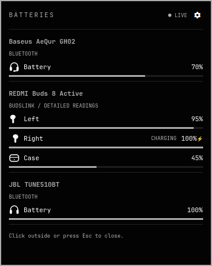
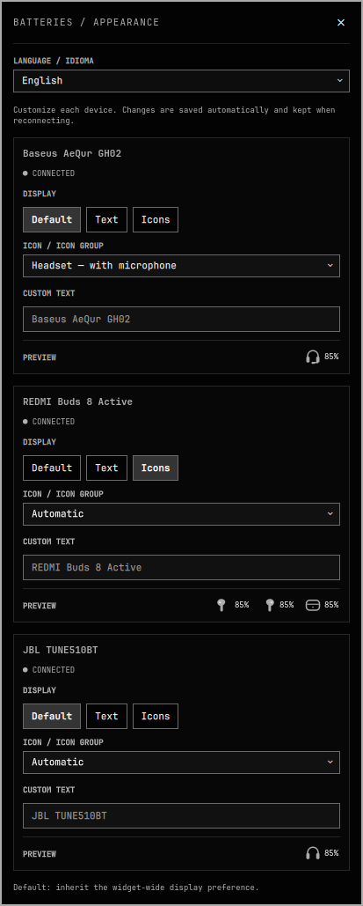

# Omarchy Device Battery

Bluetooth battery widget for **Omarchy's Quickshell-based shell**. Combines
standard BlueZ battery readings with detailed [BudsLink](https://github.com/maniacx/BudsLink)
readings, with a native panel and per-device appearance settings.

| Live battery overview | Per-device appearance settings |
| --- | --- |
|  |  |

Real connected devices: Baseus AeQur GH02, REDMI Buds 8 Active and JBL TUNE510BT.
The settings image stitches two scroll positions to show all three device cards;
its 85% preview values are samples, while the overview shows live readings.

[Português brasileiro](README.pt-BR.md)

## Features

- Show multiple connected devices together: headphones, earbuds and other
  Bluetooth peripherals that expose a battery percentage.
- Prefer BudsLink's left/right/case readings when available, otherwise show
  the standard BlueZ percentage. Never duplicate the same device.
- Hide disconnected devices and devices without valid battery readings.
- Choose text or icons per device, with optional custom text.
- Choose three distinct headphone/headset designs, earbud/case icon groups,
  a speaker, mouse, keyboard or battery icon.
- Pin the live battery panel with **left click**. Open settings with
  **right click** or the panel's **gear** button. Escape/outside click closes.
- Native Omarchy controls, theme colors and fonts; settings survive reconnects.

Choose **Português (Brasil)** or **English** using the language selector at the
top of settings. The choice is saved and updates panels, tooltips and icon names
immediately, without changing device names or per-device preferences.
In detailed text mode, English uses **L/R/C** (left/right/case) and Portuguese
uses **E/D/C**. `⚡` means charging; `—` means unavailable, not 0%.

## Requirements

- A recent Omarchy installation with `omarchy plugin` and the Quickshell shell
  (`qs.Ui`, `qs.Commons`, inline widget settings). **Not a Waybar module.**
- `gjs` and a working BlueZ system service.
- Optional: BudsLink Flatpak for detailed supported-earbud readings.

## Install

```bash
omarchy pkg add gjs
omarchy plugin add https://github.com/Felipe-martins-s/omarchy-device-battery --enable
```

To place it next to Bluetooth:

```bash
omarchy plugin enable flpems.device-battery --section right --after omarchy.bluetooth
```

The plugin ID is **`flpems.device-battery`** (renamed from `flpems.buds-battery`
in v0.5.0).

### Optional: detailed earbud/case readings

```bash
omarchy pkg add flatpak
flatpak remote-add --user --if-not-exists flathub https://flathub.org/repo/flathub.flatpakrepo
flatpak install --user flathub io.github.maniacx.BudsLink
```

Open BudsLink to confirm that your model exposes the readings. Detailed readings
have been tested with **REDMI Buds 8 Active**; this is not a claim that all
BudsLink models have been tested with this widget.

The widget can start BudsLink without a window for connected Redmi/Xiaomi devices
advertising UUID FD2D. **Other brands currently require starting BudsLink yourself.**
For the tested Redmi model, case readings may require an earbud inside the case
and the lid open. A phone companion app can occupy the control connection;
disconnect it if BudsLink cannot read the earbuds.

## Configure

Right-click the widget. Each connected device can use:

- **Default / Padrão**: inherit the widget-wide text/icon default.
- **Text / Texto**: use text, optionally with a custom label.
- **Icons / Ícones**: use the selected icon or earbud/case group.

Edited devices remain in settings while disconnected, but are hidden from the
bar. Preferences live locally in the widget's `devicePreferences` entry in
`~/.config/omarchy/shell.json`, keyed by Bluetooth address. No personal device
preferences are included in this repository.

## Update

```bash
omarchy plugin update flpems.device-battery
```

If updated code retains old behavior after hot reload, use
`omarchy restart shell` (briefly restarts the shell and bar).

## Disable or remove

**Back up `~/.config/omarchy/shell.json` first if you want to retain your
preferences and bar position.** Current Omarchy disable/remove behavior removes
the inline widget entry, so re-enabling may use a new default entry. This is a
host behavior, not a separate settings backup managed by this plugin. Restore
only this widget's saved entry rather than replacing unrelated configuration.

Disable without deleting the code:

```bash
omarchy plugin disable flpems.device-battery
```

Remove through Omarchy's normal confirmation flow:

```bash
omarchy plugin remove flpems.device-battery
```

Back up any preferences you want to retain before removal. This does not uninstall
GJS or BudsLink and does not disable Bluetooth. The plugin has no custom installer
or uninstall hooks and never removes other applications or their configuration.

If you already installed an unmanaged copy from OmarchyMac-Configs, back it up
outside `~/.config/omarchy/plugins/` before installing this repository. The
installer refuses a duplicate ID. Keep your `shell.json` preferences.

### Upgrading from v0.4.0

Back up your plugin directory and `~/.config/omarchy/shell.json` first. Update
the code, then rename the old plugin directory to `flpems.device-battery` and
change the old widget entry's `id` to `flpems.device-battery` in `shell.json`.
Keep all other entry fields, including `devicePreferences` and `displayMode`,
and keep the entry in its existing bar section/position. Do not leave both IDs
enabled. Restart the shell after migration. Use the new ID for future updates.

## Troubleshooting and limitations

- Connected does not always mean a battery is available: the device must expose
  `org.bluez.Battery1.Percentage`, or a valid BudsLink reading.
- Standard BlueZ supplies a single percentage, not left/right/case percentages.
- Detailed readings depend on what the device and BudsLink report.
- The widget reads D-Bus APIs, not a second earbud control socket.
- Device events update the widget, with a five-second polling fallback.
- The widget does not install or modify BudsLink, BlueZ, system services or
  files under `/usr/share/omarchy/`.
- The settings preview uses **85% as sample data**, not a live battery reading.

Run the reader directly for diagnostics (Ctrl+C to stop):

```bash
gjs -m ~/.config/omarchy/plugins/flpems.device-battery/reader.js
```

Its output contains device names and Bluetooth paths/addresses. **Redact these
before posting logs publicly.**

## Permissions, privacy and process lifecycle

The QML UI runs **unsandboxed inside the existing Omarchy shell**, with your user
permissions. It does not start another Quickshell process. A local GJS helper
reads BlueZ device/connection/battery properties on the system D-Bus and BudsLink's
device properties on the user-session D-Bus. The helper does not open a second
Bluetooth control socket.

Runtime code does not request privilege elevation, download code, install
packages, change system services or access credentials. The dependency commands
above are explicit user-run package installations; Omarchy may ask for
authorization. Optional BudsLink is installed from Flathub by the user, not
downloaded or installed by the widget.

When compatible Redmi/Xiaomi devices are connected, the helper may launch an
**already-installed** BudsLink Flatpak in service mode. It uses BudsLink's
`HoldService`/`ReleaseService` API while devices are present. Disabling/unloading
the widget stops its managed helper; the app owns its remaining lifecycle and
open windows. The widget does not force-kill BudsLink or any system daemon.

Settings changes write only the widget's own inline settings through Omarchy's
configuration API, after user interaction. Device names/addresses and preferences
remain local. No analytics or telemetry are sent by the widget. BudsLink's own
permissions and behavior are a separate dependency, not sandboxed by this plugin.

## Development

```bash
git clone https://github.com/Felipe-martins-s/omarchy-device-battery
cd omarchy-device-battery
gjs -m tests.js
gjs -m tests-i18n.js
omarchy plugin validate .
bash tools/check-qml.sh
```

Tests cover source priority, deduplication, disconnects, multiple devices,
missing/invalid values and valid 0% readings. They do not replace live QML/UI
and Bluetooth-device testing. CI runs these merging tests and checks JSON.

The QML checker uses the installed shell's imports and `qmllint`; it creates
temporary import aliases **outside** the plugin and does not modify Omarchy.

## Reporting issues

For issues, include your Omarchy/BudsLink versions, device model, data source
and reproduction steps. Do not upload your full `shell.json`, unredacted
diagnostic output or screenshots of unrelated windows.

## License and credits

[MIT](LICENSE). Original widget and monochrome icon artwork.

Uses the public APIs of [BlueZ](https://www.bluez.org/) and
[BudsLink](https://github.com/maniacx/BudsLink). UI uses Omarchy's own shared
components, with no dependency on other third-party panel plugins.
Independent community plugin, not an official Omarchy or BudsLink project.
