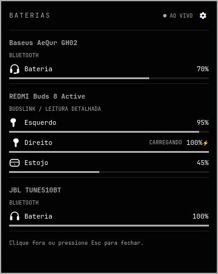
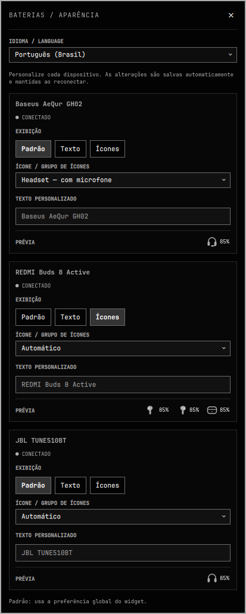

# Omarchy Device Battery

Widget de baterias para o **shell Quickshell do Omarchy**. Combina as leituras
Bluetooth padrão (BlueZ) com as baterias separadas de fones/estojo do BudsLink.

| Painel geral | Configurações por dispositivo |
| --- | --- |
|  |  |

Dispositivos reais conectados: Baseus AeQur GH02, REDMI Buds 8 Active e JBL TUNE510BT.
A imagem das configurações une duas posições de rolagem para mostrar os três
cartões; os 85% das prévias são exemplos, enquanto o painel geral usa leituras reais.

## Instalar

```bash
omarchy pkg add gjs
omarchy plugin add https://github.com/Felipe-martins-s/omarchy-device-battery --enable
```

ID do plugin: `flpems.device-battery` (antes `flpems.buds-battery`). Não é um módulo para Waybar.

Para posicioná-lo ao lado do Bluetooth:

```bash
omarchy plugin enable flpems.device-battery --section right --after omarchy.bluetooth
```

## BudsLink (opcional)

Somente para leituras detalhadas em modelos compatíveis:

```bash
omarchy pkg add flatpak
flatpak remote-add --user --if-not-exists flathub https://flathub.org/repo/flathub.flatpakrepo
flatpak install --user flathub io.github.maniacx.BudsLink
```

Leituras detalhadas testadas com **REDMI Buds 8 Active**. A inicialização automática
do BudsLink é limitada a Redmi/Xiaomi com UUID FD2D; para outras marcas, abra-o
manualmente. A bateria do estojo depende do modelo; no Redmi testado, deixe um
fone no estojo com a tampa aberta. Desconecte o aplicativo do celular se ele
estiver ocupando a conexão de controle.

## Usar

- **Idioma / Language**, no topo das configurações: escolha **Português (Brasil)**
  ou **English**. A escolha é salva e traduz painéis, dicas e nomes de ícones
  imediatamente, sem alterar os nomes nem as preferências dos aparelhos.
- **Clique esquerdo:** fixa o painel de baterias.
- **Clique direito ou engrenagem:** configura cada dispositivo.
- **Texto/ícones:** escolha por aparelho, com texto personalizado e ícones
  diferentes de headphone/headset ou grupos de fones + estojo.
- **E/D/C:** esquerdo, direito e caixa (em inglês, **L/R/C**). `⚡`: carregando. `—`: indisponível.
- Desconectados/sem leitura ficam ocultos. Fontes não são duplicadas.
- A prévia das configurações usa **85% fictícios**, não a leitura atual.

Preferências ficam em `devicePreferences` na entrada do widget em
`~/.config/omarchy/shell.json`; são mantidas ao reconectar. Não são enviadas ao
repositório. O padrão global só afeta aparelhos sem uma escolha própria.

## Atualizar

```bash
omarchy plugin update flpems.device-battery
```

Se a recarga mantiver o código antigo, `omarchy restart shell` reinicia brevemente
a barra e o shell. Para desativar: `omarchy plugin disable flpems.device-battery`.

## Remover

**Faça backup do `~/.config/omarchy/shell.json` antes de desativar ou remover.**
O Omarchy atual remove a entrada inline do widget, incluindo preferências e
posição; ao reativar, pode criar uma entrada padrão. Para preservar as escolhas,
restaure somente a entrada deste widget, sem sobrescrever outras configurações.

```bash
omarchy plugin remove flpems.device-battery
```

O comando usa a confirmação padrão do Omarchy. Faça backup das preferências que
quiser manter. Não desinstala GJS/BudsLink nem desativa o Bluetooth, e não há
instalador ou desinstalador próprio.

## Permissões

O QML roda no processo existente do shell, sem sandbox. Um helper GJS lê o D-Bus
do BlueZ e do BudsLink; não abre outro socket de controle do fone. O widget não
pede privilégios, baixa código nem instala pacotes em execução. As instalações
das dependências acima são comandos explícitos do usuário.

O helper pode abrir o BudsLink já instalado em modo serviço para Redmi/Xiaomi
compatíveis e usar a API de retenção/liberação enquanto necessário. Não força
o encerramento de janelas nem modifica serviços do sistema. Configurações são
salvas somente na entrada do próprio widget, por ação do usuário. Nomes e
endereços permanecem locais; o widget não envia telemetria.

Já instalou a cópia manual do OmarchyMac-Configs? Faça backup dela fora de
`~/.config/omarchy/plugins/` antes de instalar pelo Git, evitando ID duplicado.
Mantenha as preferências do `shell.json`.

### Migração da v0.4.0

Faça backup do diretório do plugin e do `shell.json`. Após atualizar o código,
renomeie a pasta antiga para `flpems.device-battery` e altere somente o `id` da
entrada antiga no `shell.json` para o novo ID. Preserve `devicePreferences`,
`displayMode`, os demais campos e a posição na barra. Não deixe os dois IDs
ativos. Reinicie o shell e use o novo ID nas próximas atualizações.

Consulte o [README completo](README.md) para requisitos, testes e limitações.
Ao reportar problemas, remova endereços Bluetooth e dados pessoais dos logs.

Licença [MIT](LICENSE). Plugin comunitário independente de Omarchy e BudsLink.
